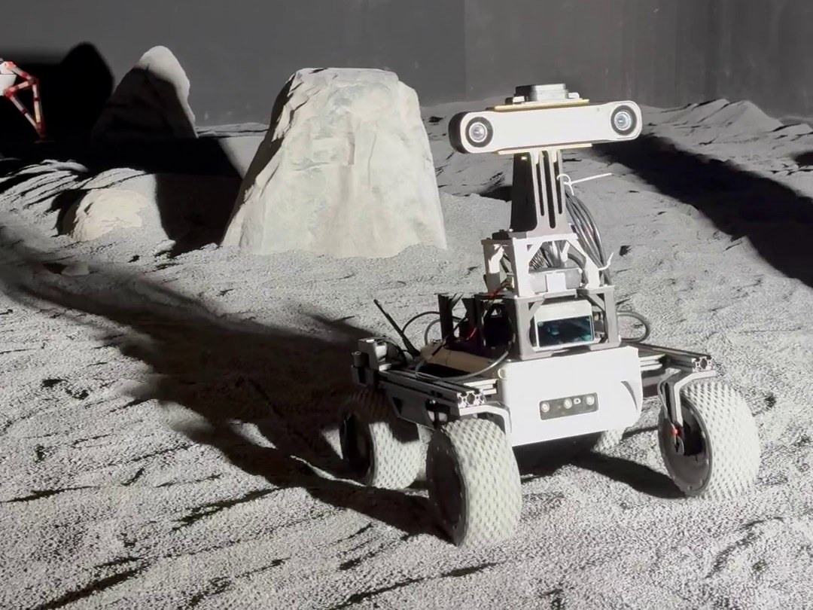
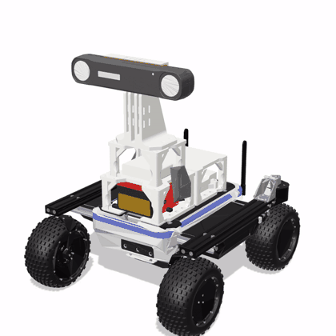
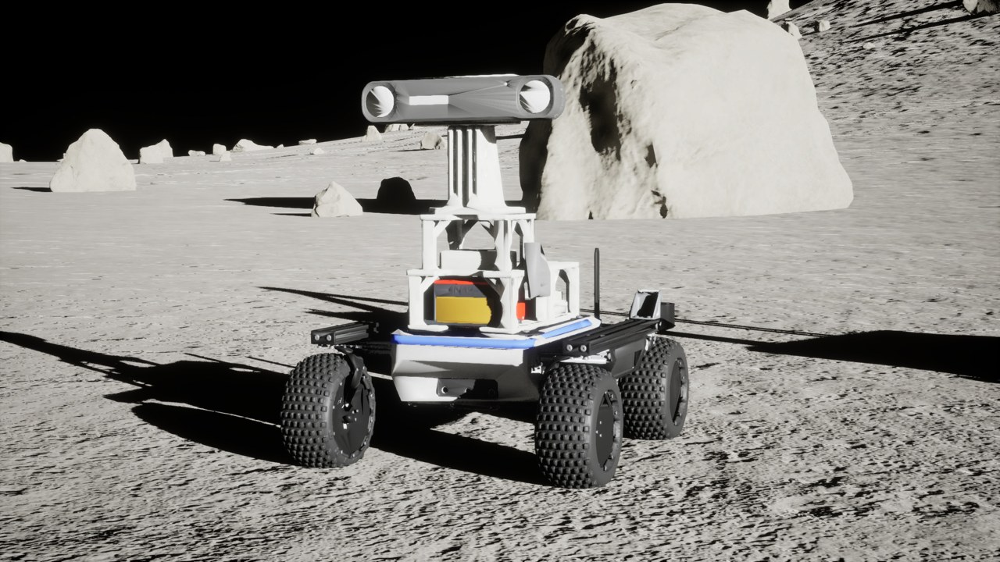

# SpaceR Raph Rover ROS 2



Docker Compose ROS 2 stack used at SpaceR for Fictionlab's **Raph Rover**, an
Ackermann-steered mobile robot running on an NVIDIA Jetson Orin Nano. Every component is a
self-contained service; ROS nodes communicate over **Zenoh** (`rmw_zenoh_cpp`), with the
base controller bridged in through a DDS relay. All containers run **ROS 2 Jazzy**
(Ubuntu 24.04).

**Author:** Raúl Castilla Arquillo, Space Robotics Research Group
([SpaceR](https://www.uni.lu/snt-en/research-groups/spacer/)), SnT, University of Luxembourg,
in collaboration with Javier Urbaneja Sánchez (SpaceR). The sensor payload was designed by
Gabriel García (SpaceR).

## Hardware

<p align="center">
  
</p>

Fictionlab's Raph Rover base, with its onboard computer replaced by a Jetson Orin Nano, and
SpaceR's sensor payload:

- **Navcam:** Teledyne FLIR Bumblebee X stereo camera (GigE)
- **Loccam:** Luxonis OAK-D Pro W (USB)
- **LiDAR:** Livox HAP
- **IMU:** WIT Motion WT901C, plus the base controller's built-in IMU

Specifications, connections and additional hardware: [docs/hardware.md](docs/hardware.md).

## Digital twin in MARE



The rover has a digital twin in [MARE](https://github.com/raulcastar/MARE-Lunar-Simulator),
SpaceR's open-source lunar rover simulator in Unreal Engine 5. The twin carries the same
payload and cameras, and is driven by the ROS 2 stack
[GNC-Moon-Simulator](https://github.com/raulcastar/GNC-Moon-Simulator), so navigation and
perception can be developed in simulation before running on the robot.

## Quick start

Connect to the rover's Wi-Fi, then (first-time setup of the Jetson, including the
proprietary Spinnaker SDK, is in [docs/setup.md](docs/setup.md)):

```bash
# On the rover (Jetson)
./docker_build_robot.sh            # build and start every component

# On the operator computer (gamepad plugged in)
xhost +local:docker
./docker_build_remote.sh           # teleop + debug CLI / RViz
```

## Components

| Service | Role |
|---------|------|
| `zenoh_router` | `rmw_zenohd` Zenoh router, tuned for large point-cloud fragmentation to remote peers. Start first. |
| `leo_base_system` | `robot_state_publisher` (URDF → TF), robot description, `rapha_system` node. |
| `component-teleop` | Gamepad teleop (`joy_linux` + `rapha_teleop`) → `/controller/cmd_ackermann`. |
| `micro_ros_agent` | XRCE-DDS ↔ Fast DDS agent for the base-controller microcontroller. |
| `controller_relay_dds` / `controller_relay_zenoh` | Typed DDS ↔ Zenoh relay for controller topics/services ([details](docs/microcontroller-bridge.md)). |
| `component-bumblebee-arm64` | **navcam** — Bumblebee X forward stereo (Spinnaker/GigE). |
| `component-oak_camera` | **loccam** — OAK-D Pro W localization camera (depthai). |
| `component-livox_lidar` | **lidar** — Livox HAP LiDAR. |
| `component-wit_imu` | External WIT WT901C IMU → `/imu_wit/*`. |
| `component-odometry` | Ackermann wheel odometry → `/odom` + `odom→base_footprint` TF. |
| `component-voxel-filter` | Voxel-downsampled copies of each point cloud. |
| `debug_cli` | Interactive ROS 2 CLI container with `rviz2` / `rqt`. |

`component-bumblebee_amd64/` is an x86-64 build of the same camera node; it is not used by
the compose files.

## Documentation

| Page | Contents |
|------|----------|
| [Hardware](docs/hardware.md) | Base specification, SpaceR configuration, additional hardware, 3D model |
| [Setup](docs/setup.md) | Network, one-time rover setup, running the stack on both machines |
| [Sensors](docs/sensors.md) | Topics and TF frames, camera calibration and projection |
| [Debug CLI & RViz](docs/debugging.md) | Inspecting topics and visualizing the rover |
| [Microcontroller bridge](docs/microcontroller-bridge.md) | micro-ROS agent and the DDS ↔ Zenoh relay |

## Third-party software

| Component | Source | License |
|-----------|--------|---------|
| `rapha_*` packages, including the rover meshes in `rapha_description/models/` (`component-leo_base_system`, `component-teleop`) | Fictionlab | MIT |
| `livox_ros_driver2` (`component-livox_lidar`) | Livox | MIT (see its `LICENSE.txt`) |
| `wit_imu_driver` (`component-wit_imu`) | WIT Motion driver by Eric Feng | MIT (see its `LICENSE`) |
| CH341 USB-serial driver (`component-wit_imu/.../CH341SER`) | WCH | GPL-3.0 (see its `LICENSE`) |
| Spinnaker SDK (`component-bumblebee_*`, not included) | Teledyne FLIR | Proprietary, FLIR EULA |

## License

The rest of this repository is released under the [MIT License](LICENSE), © Raúl Castilla
Arquillo, Space Robotics Research Group (SpaceR), SnT, University of Luxembourg.
