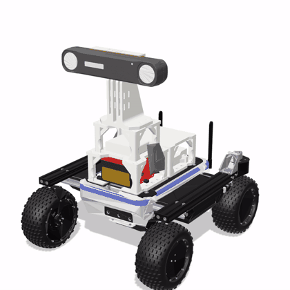
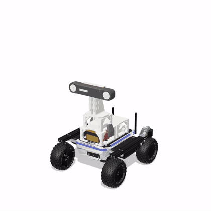

# Hardware

The Raph Rover as used at SpaceR: Fictionlab's base and SpaceR's sensor payload.

## Raph Rover base

The base is Fictionlab's stock Raph Rover ([specification](https://docs.fictionlab.pl/raph-rover/documentation/specification)):

| | |
|---|---|
| Size, weight, payload | 559 × 474 × 255 mm, 12.5 kg, up to 10 kg payload |
| Drive | Six BLDC motors on an RS-485 bus: four wheels, two independently steered at the rear (Ackermann or turn-in-place); up to 1.8 m/s |
| Controller | RaphCore (STM32H563, FreeRTOS, micro-ROS) with a TDK ICM-42605 IMU |
| Computer | UP Board 7000 (Intel N100, 8 GB); replaced by a Jetson Orin Nano at SpaceR |
| Power | Two hot-swappable 6S 4 Ah Li-ion packs, about 4 h of operation |
| Network | Teltonika RUTX10 router, dual-band Wi-Fi (2.4 and 5 GHz) |
| Environment | IP54, −10 to +40 °C |
| Stock sensors | Luxonis OAK-D Pro W stereo camera (kept), RPLidar S3 2D LiDAR (not fitted at SpaceR) |

## SpaceR configuration

The sensor payload on the base, and the hardware this stack drives:

| Component | Model | Connection | In this stack |
|---|---|---|---|
| Base controller | RaphCore (Fictionlab) | Ethernet, `10.10.0.211` | Motors, steering, wheel encoders, LEDs and its IMU, over micro-ROS: `/controller/*` |
| Onboard computer | NVIDIA Jetson Orin Nano | Ethernet, `10.10.0.15` | Runs every component and the Zenoh router |
| Ethernet switch | PoE switch | Ethernet | Links the Jetson's single port (`enP8p1s0`) to the stereo camera, the LiDAR and the base controller |
| Stereo camera (navcam) | [Teledyne FLIR Bumblebee X](https://www.teledynevisionsolutions.com/products/bumblebee-x/) | GigE, `10.10.0.17` | Forward stereo on the mast, 0.35 m above the LiDAR; `/navcam/*`, 2 fps, quarter resolution by default |
| Localization camera (loccam) | [Luxonis OAK-D Pro W](https://docs.luxonis.com/hardware/products/OAK-D%20Pro%20W) | USB | Wide-angle RGB and stereo depth; `/loccam/*`, 2 fps; IR dot projector off by default |
| LiDAR | [Livox HAP](https://www.livoxtech.com/hap) | Ethernet, LiDAR subnet (Jetson at `192.168.1.5`) | 3D point cloud; `/lidar/points`, 1 Hz |
| IMU | [WIT Motion WT901C](https://www.wit-motion.com/) | USB serial (CH341), 115200 baud | 9-axis attitude sensor; `/imu_wit/*` |
| Network | Teltonika RUTX10 (stock router) | — | Links the rover and the operator laptop |
| Operator station | Laptop and gamepad | Wi-Fi | Gamepad teleop, RViz and the debug CLI |

## Additional hardware

Mounted or planned on the rover, but not yet integrated in this ROS 2 stack:

| Component | Model | Purpose |
|---|---|---|
| Auxiliary computer | Raspberry Pi 5 (8 GB) | Hosts the RTK receiver |
| RTK GNSS | u-blox ZED-F9P GPS-RTK HAT | Centimetre-level outdoor positioning |
| Low-power computer | Raspberry Pi Zero 2 W | Auxiliary tasks |
| Real-time clock | RTC module | Keeps time without network |
| Power and wiring | Voltage regulators, inline fuses, 12/14 AWG silicone cable, pluggable terminals, USB-C hubs, LED strip | Power distribution for the added electronics |

## 3D model

  
  

*The Raph Rover base (Fictionlab) with the SpaceR sensor payload designed by Gabriel García:
the stereo-camera mast and the mounts for the LiDAR and the electronics (right: the payload
lifted off the base).*
